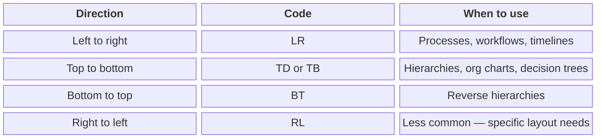
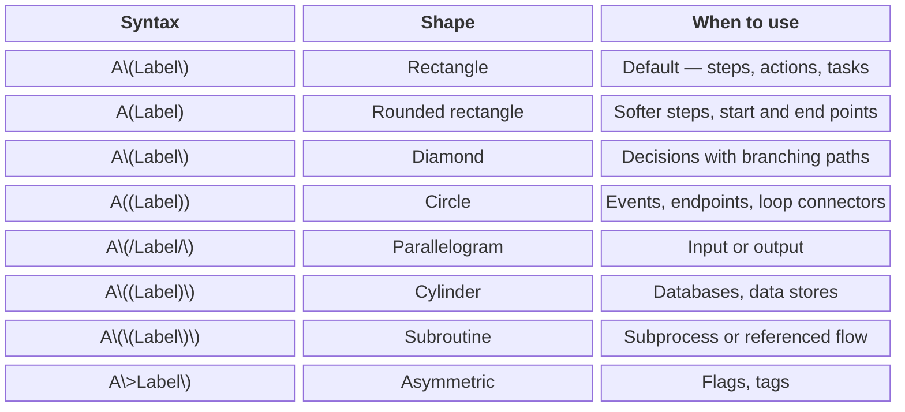

# Write diagram syntax <a id="write-diagram-syntax"></a>

Mermaid syntax is plain text with a defined structure. Once you understand the basics, you can build and edit any diagram without touching the AI panel — and you’ll know exactly what to change when a diagram needs updating.
This guide covers flowchart syntax in depth. For other diagram types, the same principles apply; the OSS docs have full syntax references for every type. [Browse the OSS syntax docs →](https://mermaid.js.org/intro/)
## How syntax works <a id="how-syntax-works"></a>

Every diagram starts with a type declaration that tells Mermaid what kind of diagram to render:
```plaintext
flowchart LR
sequenceDiagram
erDiagram
mindmap
gantt
```

Everything that follows defines the content — nodes, connections, labels, styles, and groupings. The diagram renders in real time as you type in the editor.
## Flowchart direction <a id="flowchart-direction"></a>

For flowcharts, the direction comes right after the type declaration:


| Direction | Code | When to use |
|---|---|---|
| Left to right | LR | Processes, workflows, timelines |
| Top to bottom | TD or TB | Hierarchies, org charts, decision trees |
| Bottom to top | BT | Reverse hierarchies |
| Right to left | RL | Less common — specific layout needs |


Direction has a bigger impact on readability than most people expect. The same diagram can be clear or cluttered depending on which way it flows. If a layout looks off, try changing the direction before adjusting anything else.
## Nodes <a id="nodes"></a>

Nodes are the building blocks of a flowchart. Shape carries meaning — use it deliberately.


| Syntax | Shape | When to use |
|---|---|---|
| A\[Label\] | Rectangle | Default — steps, actions, tasks |
| A(Label) | Rounded rectangle | Softer steps, start and end points |
| A\{Label\} | Diamond | Decisions with branching paths |
| A((Label)) | Circle | Events, endpoints, loop connectors |
| A\[/Label/\] | Parallelogram | Input or output |
| A\[(Label)\] | Cylinder | Databases, data stores |
| A\[\[Label\]\] | Subroutine | Subprocess or referenced flow |
| A\>Label\] | Asymmetric | Flags, tags |


Node IDs and labels are separate. The ID is used to reference the node in connections — the label is what renders in the diagram. Define the label once and use the ID everywhere else:
flowchart LR
    A[Content brief] --> B[Draft]
    B --> C{Ready for review?}
    C -->|Yes| D[Send to reviewer]
    C -->|No| B
    D --> E[Published]
Tip: Don't use the word end in all lowercase as a node ID or label — it's a reserved word and breaks the parser. Use End, END, or a different word entirely.
## Connections <a id="connections"></a>

Connection type carries meaning. Use the right one for what you’re showing.
```mermaid
block-beta
columns 3
  h_0["<b>Syntax</b>"]
  h_1["<b>Renders as</b>"]
  h_2["<b>When to use