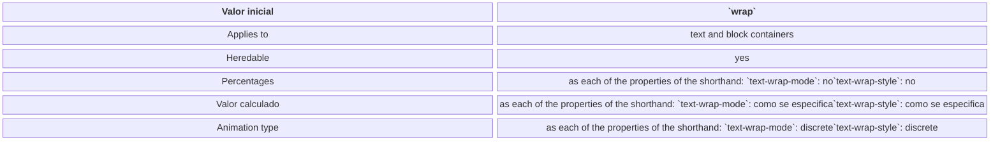
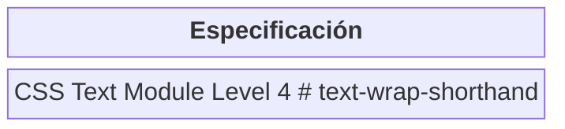

# text-wrap

> **Baseline
        
        Ampliamente disponible
        \***

Esta característica está consolidada y funciona en muchos dispositivos y versiones de navegador. Está disponible en todos los navegadores desde marzo de 2024.

                \* Algunas partes de esta característica pueden tener distintos niveles de compatibilidad.
- 
            [
              Ver la compatibilidad completa
            ](#compatibilidad_con_navegadores)
          
- 
            [
              Más información
            ](/es/docs/Glossary/Baseline/Compatibility)
          

La propiedad abreviada de CSS **`text-wrap`** controla cómo se envuelve el texto dentro de un elemento. Los diferentes valores proporcionan:
- Mejoras tipográficas, por ejemplo, longitudes de línea más equilibradas en títulos divididos.
- Una forma de desactivar completamente el ajuste de texto.

**Nota:**
Las propiedades [`white-space-collapse`](/en-US/docs/Web/CSS/Reference/Properties/white-space-collapse) y `text-wrap` pueden declararse juntas usando la propiedad abreviada [`white-space`](/es/docs/Web/CSS/Reference/Properties/white-space).
## [Pruébalo](#pruébalo) <a id="pruébalo"></a>

```css
text-wrap: wrap;
```

```css
text-wrap: nowrap;
```

```css
text-wrap: balance;
```

```css
text-wrap: pretty;
```

```css
text-wrap: stable;
```

```html
<section class="default-example" id="default-example">
  <div class="whole-content-wrapper">
    <p>Edit the text in the box:</p>
    <div class="transition-all" id="example-element">
      <p contenteditable="">
        Lorem ipsum dolor sit amet consectetur adipisicing elit. Voluptatem aut
        cum eum id quos est.
      </p>
    </div>
  </div>
</section>
```

```css
.whole-content-wrapper {
  display: flex;
  flex-direction: column;
  align-items: center;
  width: 100%;
}

#example-element {
  border: 1px solid #c5c5c5;
  width: 250px;
}
```

## [Propiedades constituyentes](#propiedades_constituyentes) <a id="propiedades_constituyentes"></a>

Esta propiedad es una abreviatura de las siguientes propiedades de CSS:
- [`text-wrap-mode`](/en-US/docs/Web/CSS/Reference/Properties/text-wrap-mode)
- [`text-wrap-style`](/en-US/docs/Web/CSS/Reference/Properties/text-wrap-style)

## [Sintaxis](#sintaxis) <a id="sintaxis"></a>
css

```css
/* Valores de palabras clave */
text-wrap: wrap;
text-wrap: nowrap;
text-wrap: balance;
text-wrap: pretty;
text-wrap: stable;

/* Valores globales */
text-wrap: inherit;
text-wrap: initial;
text-wrap: revert;
text-wrap: revert-layer;
text-wrap: unset;
```

La propiedad `text-wrap` se especifica como una palabra clave única elegida de la lista de valores a continuación.
### [Valores](#valores) <a id="valores"></a>
[`wrap`](#wrap)

El texto se envuelve en líneas en caracteres apropiados (por ejemplo, espacios en idiomas como el inglés que usan separadores de espacio) para minimizar el desbordamiento. Este es el valor predeterminado.
[`nowrap`](#nowrap)
El texto no se envuelve en líneas. Desbordará su elemento contenedor en lugar de dividirse en una nueva línea.
[`balance`](#balance)
El texto se envuelve de una manera que equilibra mejor el número de caracteres en cada línea, mejorando la calidad y la legibilidad del diseño. Dado que contar caracteres y equilibrarlos en varias líneas es computacionalmente costoso, este valor solo es compatible con bloques de texto que abarcan un número limitado de líneas (seis o menos para Chromium y diez o menos para Firefox).
[`pretty`](#pretty)
Da como resultado el mismo comportamiento que `wrap`, excepto que el agente de usuario utilizará un algoritmo más lento que favorece un mejor diseño sobre la velocidad. Esto está destinado al texto principal donde se prefiere una buena tipografía sobre el rendimiento (por ejemplo, cuando se debe minimizar el número de palabras [huérfanas](/en-US/docs/Web/CSS/Reference/Properties/orphans)).
[`stable`](#stable)
Da como resultado el mismo comportamiento que `wrap`, excepto que cuando el usuario está editando el contenido, las líneas que preceden a las líneas que están editando permanecen estáticas en lugar de que todo el bloque de texto se vuelva a ajustar.
## [Descripción](#descripción) <a id="descripción"></a>

Hay dos formas en que el texto puede fluir a través de líneas dentro de un bloque de contenido, como un párrafo ([`<p>`](/es/docs/Web/HTML/Reference/Elements/p)) o encabezados ([\<h1\>–\<h6\>](/es/docs/Web/HTML/Reference/Elements/Heading_Elements)). Estos son *saltos de línea forzados*, que son controlados por el usuario, y *saltos de línea suaves*, que son controlados por el navegador. La propiedad `text-wrap` se puede usar para indicar al navegador cómo controlar los *saltos de línea suaves*.
El valor que elija para `text-wrap` depende de cuántas líneas de texto anticipe estilizar, si el texto es `contenteditable` (contenido editable), y si necesita priorizar la apariencia o el rendimiento.
Cuando el contenido estilizado se limitará a un número corto de líneas, como títulos, leyendas y citas en bloque, se puede agregar `` text-wrap: balance `` para equilibrar el número de caracteres en cada línea, mejorando la calidad y la legibilidad del diseño. Dado que los navegadores limitan el número de líneas afectadas por esta propiedad, el impacto de este valor en el rendimiento es insignificante.
Para secciones de texto más largas, se puede usar `` text-wrap: pretty ``. Tenga en cuenta que `pretty` tiene un efecto negativo en el rendimiento, por lo que solo debe usarse para bloques de texto más largos cuando el diseño es más importante que la velocidad.
El valor `stable` mejora la experiencia del usuario cuando se usa en  (contenido que es editable). Este valor asegura que, a medida que el usuario está editando texto, las líneas anteriores en el área que se está editando permanezcan estables.
## [Definición formal](#definición_formal) <a id="definición_formal"></a>



| [Valor inicial](/es/docs/Web/CSS/Guides/Cascade/Property_value_processing#initial_value) | `wrap` |
|---|---|
| Applies to | text and block containers |
| [Heredable](/es/docs/Web/CSS/Guides/Cascade/Inheritance) | yes |
| Percentages | as each of the properties of the shorthand:   [`text-wrap-mode`](/en-US/docs/Web/CSS/Reference/Properties/text-wrap-mode): no[`text-wrap-style`](/en-US/docs/Web/CSS/Reference/Properties/text-wrap-style): no |
| [Valor calculado](/es/docs/Web/CSS/Guides/Cascade/Property_value_processing#computed_value) | as each of the properties of the shorthand:   [`text-wrap-mode`](/en-US/docs/Web/CSS/Reference/Properties/text-wrap-mode): como se especifica[`text-wrap-style`](/en-US/docs/Web/CSS/Reference/Properties/text-wrap-style): como se especifica |
| [Animation type](/en-US/docs/Web/CSS/Guides/Animations/Animatable_properties) | as each of the properties of the shorthand:   [`text-wrap-mode`](/en-US/docs/Web/CSS/Reference/Properties/text-wrap-mode): discrete[`text-wrap-style`](/en-US/docs/Web/CSS/Reference/Properties/text-wrap-style): discrete |


## [Sintaxis formal](#sintaxis_formal) <a id="sintaxis_formal"></a>

```text
text-wrap =   <'text-wrap-mode'>   ||  <'text-wrap-style'>  <text-wrap-mode> =   wrap    |  nowrap  <text-wrap-style> =   auto                   |  balance                |  stable                 |  pretty                 |  avoid-short-last-line
```

## [Ejemplos](#ejemplos) <a id="ejemplos"></a>

### [Comparación de valores básicos de text-wrap](#comparación_de_valores_básicos_de_text-wrap) <a id="comparación_de_valores_básicos_de_text-wrap"></a>

#### HTML <a id="html"></a>
html

```html
<h2 class="wrap" contenteditable="true">
  El comportamiento predeterminado; el texto en el título se envuelve
  "normalmente"
</h2>

<h2 class="nowrap" contenteditable="true">
  En este caso, el texto en el título no se envuelve y desborda el contenedor
</h2>

<h2 class="balance" contenteditable="true">
  En este caso, el texto en el título está bien equilibrado entre líneas
</h2>
```

### [CSS](#css) <a id="css"></a>
css

```css
.wrap {
  text-wrap: wrap;
}

.nowrap {
  text-wrap: nowrap;
}

.balance {
  text-wrap: balance;
}

h2 {
  font-size: 2rem;
  font-family: sans-serif;
}
```

#### Resultado <a id="resultado"></a>

El texto en el ejemplo es editable. Cambie el texto, agregando palabras largas, para ver cómo las diferentes longitudes de la línea y las palabras impactan el envoltorio.
## [Especificaciones](#especificaciones) <a id="especificaciones"></a>



| Especificación |
|---|
| [CSS Text Module Level 4   # text-wrap-shorthand](https://drafts.csswg.org/css-text-4/#text-wrap-shorthand) |


## [Compatibilidad con los navegadores](#compatibilidad_con_los_navegadores) <a id="compatibilidad_con_los_navegadores"></a>

## [Véase también](#véase_también) <a id="véase_también"></a>

- [`white-space`](/es/docs/Web/CSS/Reference/Properties/white-space)
- [`white-space-collapse`](/en-US/docs/Web/CSS/Reference/Properties/white-space-collapse)
- [Módulo de texto CSS](/es/docs/Web/CSS/Guides/Text)
- [CSS `` text-wrap: balance ``](https://developer.chrome.com/docs/css-ui/css-text-wrap-balance) en developer.chrome.com
- [CSS `` text-wrap: pretty ``](https://developer.chrome.com/blog/css-text-wrap-pretty/) en developer.chrome.com

## Ayuda a mejorar MDN <a id="feedback"></a>
[Aprende cómo colaborar](/es/docs/MDN/Community/Getting_started)


    Esta página se modificó por última vez el 31 mar 2026 por [colaboradores de MDN](/es/docs/Web/CSS/Reference/Properties/text-wrap/contributors.txt).
[Ver esta página en GitHub](https://github.com/mdn/translated-content/blob/main/files/es/web/css/reference/properties/text-wrap/index.md?plain=1)
 • 
[Informar de un problema con este contenido](https://github.com/mdn/translated-content/issues/new?template=page-report-es.yml&mdn-url=https%3A%2F%2Fdeveloper.mozilla.org%2Fes%2Fdocs%2FWeb%2FCSS%2FReference%2FProperties%2Ftext-wrap&metadata=%3C%21--+Do+not+make+changes+below+this+line+--%3E%0A%3Cdetails%3E%0A%3Csummary%3EPage+report+details%3C%2Fsummary%3E%0A%0A*+Folder%3A+%60es%2Fweb%2Fcss%2Freference%2Fproperties%2Ftext-wrap%60%0A*+MDN+URL%3A+https%3A%2F%2Fdeveloper.mozilla.org%2Fes%2Fdocs%2FWeb%2FCSS%2FReference%2FProperties%2Ftext-wrap%0A*+GitHub+URL%3A+https%3A%2F%2Fgithub.com%2Fmdn%2Ftranslated-content%2Fblob%2Fmain%2Ffiles%2Fes%2Fweb%2Fcss%2Freference%2Fproperties%2Ftext-wrap%2Findex.md%0A*+Last+commit%3A+https%3A%2F%2Fgithub.com%2Fmdn%2Ftranslated-content%2Fcommit%2F03cd8e77b604d27540a3cc646d240e2457f31b13%0A*+Document+last+modified%3A+2026-03-31T01%3A22%3A11.000Z%0A%0A%3C%2Fdetails%3E)